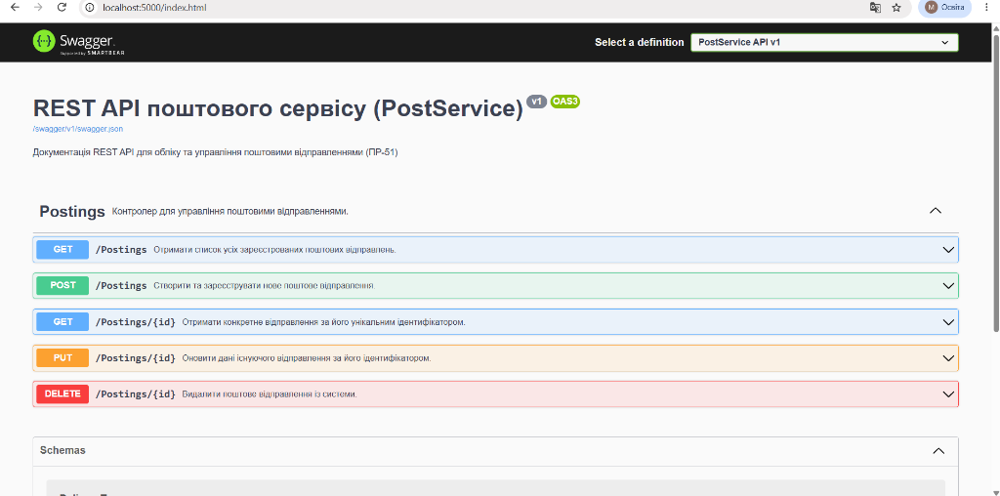
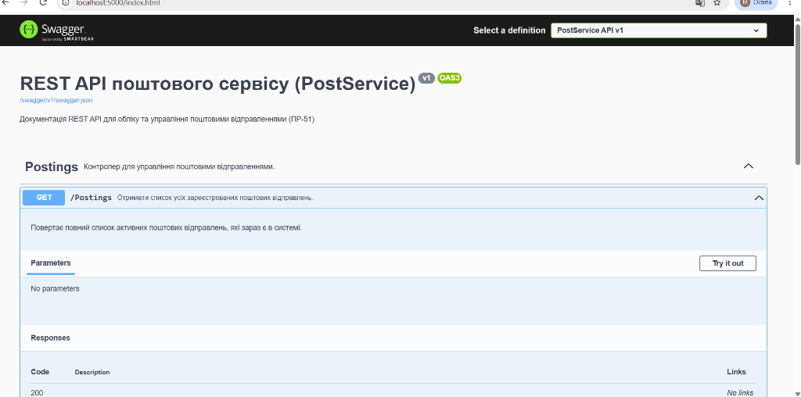

# ПР-51 Створення Swagger документації до REST API

**Тема:** Створення Swagger документації до REST API  
**Програмний проєкт:** `PostService` (ASP.NET Core Web API)  
**Репозиторій проєкту:** [https://github.com/m-messa-it/--51-swagger-rest-api.git](https://github.com/m-messa-it/--51-swagger-rest-api.git)

---

## Мета роботи
Ознайомитися з принципами автоматичного документування REST API у середовищі .NET; навчитися налаштовувати генерацію XML-файлу документації з коментарів у коді C#; підключити та налаштувати Swashbuckle (Swagger UI) в ASP.NET Core для наочного опису ендпойнтів, вхідних/вихідних параметрів, моделей даних (DTO) та статус-кодів HTTP відповідей.

---

## Скріншоти роботи Swagger UI

### 1. Головна сторінка Swagger UI сервісу PostService
На сторінці відображається назва та версія сервісу, опис, а також перелік усіх реалізованих маршрутів контролера `Postings` (`GET`, `POST`, `GET /{id}`, `PUT /{id}`, `DELETE /{id}`) із їхніми XML-описами.


### 2. Документація ендпойнта `GET /Postings`
Детальний опис методу отримання списку відправлень, інформація про вхідні параметри та очікувані коди відповідей сервера (HTTP 200 OK).


---

## Відповіді на контрольні запитання

### 1. Яке призначення документації програмного коду та чим документаційні коментарі відрізняються від звичайних коментарів?
Документація потрібна для того, щоб розробники могли швидко зрозуміти структуру та функціонал коду без необхідності читати кожну строчку реалізації. Вона полегшує командну розробку, підтримку та інтеграцію сервісу.  
**Відмінності:**  
* Звичайні коментарі (`//` або `/* */`) — це внутрішні текстові замітки для розробника, які компілятор повністю ігнорує та видаляє при збірці.  
* Документаційні коментарі (з трьома слешами `///`) записуються за стандартами XML. Компілятор аналізує їх і збирає в окремий `.xml` файл, вміст якого використовується IDE для підказок (IntelliSense) та генераторами документації (Swagger/OpenAPI).

---

### 2. За яких умов компілятор .NET буде генерувати зауваження warning CS1591: Missing XML comment for...?
Це попередження виникає тоді, коли у файлі проєкту `.csproj` активовано генерацію документації (`<GenerateDocumentationFile>true</GenerateDocumentationFile>`), але в коді є відкриті (`public`) класи, інтерфейси, методи чи поля без коментаря `/// <summary>`. Для внутрішніх (`internal`) та приватних (`private`) членів компілятор це попередження не генерує.

---

### 3. В яких випадках та як варто приглушувати зауваження warning CS1591?
Приглушувати це попередження доцільно, коли немає потреби коментувати кожен тривіальний геттер/сеттер у DTO-моделях або автоматично згенеровані файли, назви яких і так є самоописовими.  
**Способи приглушення:**  
1. У файлі `.csproj` всередині `<PropertyGroup>` додати рядок:
   ```xml
   <NoWarn>$(NoWarn);1591</NoWarn>
   ```
2. Прямо у файлі коду за допомогою препроцесорної директиви:
   ```csharp
   #pragma warning disable CS1591
   ```

---

### 4. Як увімкнути автоматичне генерування XML-файлу документації в проєкті .NET?
Необхідно відкрити файл проєкту `.csproj` та у секцію `<PropertyGroup>` додати параметр:
```xml
<GenerateDocumentationFile>true</GenerateDocumentationFile>
```
Після збірки (`dotnet build`) у вихідному каталозі поруч із файлом збірки `.dll` з'явиться однойменний файл `.xml`.

---

### 5. Які налаштування і де слід додати, якщо сторінка Swagger документації не показує опис ендпойнту?
1. Переконатися, що в `.csproj` увімкнено `<GenerateDocumentationFile>true</GenerateDocumentationFile>`.
2. У `Program.cs` під час налаштування Swagger підключити шлях до XML-файлу:
   ```csharp
   var xmlFilename = $"{Assembly.GetExecutingAssembly().GetName().Name}.xml";
   options.IncludeXmlComments(Path.Combine(AppContext.BaseDirectory, xmlFilename), includeControllerXmlComments: true);
   ```
3. Перевірити наявність коментаря `/// <summary>` безпосередньо над методом дії у контролері.

---

### 6. Які налаштування і де слід додати, якщо сторінка Swagger документації не показує опис схеми даних?
1. Перевірити підключення XML-файлу через `options.IncludeXmlComments`.
2. Додати документаційні коментарі `/// <summary>` над кожною властивістю у відповідних класах моделей (`Models`) та DTO.
3. Якщо класи моделей розташовані в окремій бібліотеці класів, увімкнути генерацію XML у її `.csproj` та підключити додатковий XML-файл моделей у `Program.cs`.

---

### 7. Що таке JSDoc та які теги використовуються для документування функцій, параметрів і результатів у JavaScript?
**JSDoc** — це стандарт коментування для JavaScript (аналог XML-коментарів C#), де блок починається з `/**` та завершується `*/`.  
**Основні теги:**  
* `@description` (або просто текст) — опис дії функції;  
* `@param {тип} назва опис` — документування вхідного параметра та його типу;  
* `@returns {тип} опис` — опис значення, яке повертає функція;  
* `@throws {тип}` — опис можливих виняткових ситуацій.

---

### 8. У чому полягають основні відмінності між XML-документацією C# та JSDoc у JavaScript?
1. **Синтаксис розмітки:** C# використовує XML-теги (`<summary>`, `<param name="...">`, `<returns>`), а JSDoc — спеціальні дескриптори зі знаком `@` (`@param`, `@returns`).
2. **Вимога до типів:** У C# типізація є статичною і береться безпосередньо з сигнатури методу, тому в коментарях вказується лише текстовий опис. У динамічному JavaScript тип потрібно обов'язково прописувати вручну у фігурних дужках `{string}`, `{number}` для генерації підказок в IDE.
3. **Обробка компілятором:** Компілятор C# (`Roslyn`) вбудовано перевіряє XML-коментарі та формує файл документації. У JavaScript коментарі повністю ігноруються середовищем виконання (браузером / Node.js) і обробляються лише зовнішніми генераторами (утилітою JSDoc).

---

## Висновок
Під час виконання практичної роботи № 51 було успішно підключено та налаштовано автоматичну Swagger-документацію для REST API сервісу поштових відправлень *PostService*. Я навчилася генерувати XML-документацію на етапі компіляції C# проєкту, зв'язувати її з інтерфейсом Swagger UI через метод `IncludeXmlComments` та детально описувати ендпойнти контролера і моделі даних DTO. Отримані знання дозволяють створювати зрозумілі, стандартизовані та зручні для тестування API відповідно до сучасних індустріальних вимог.
